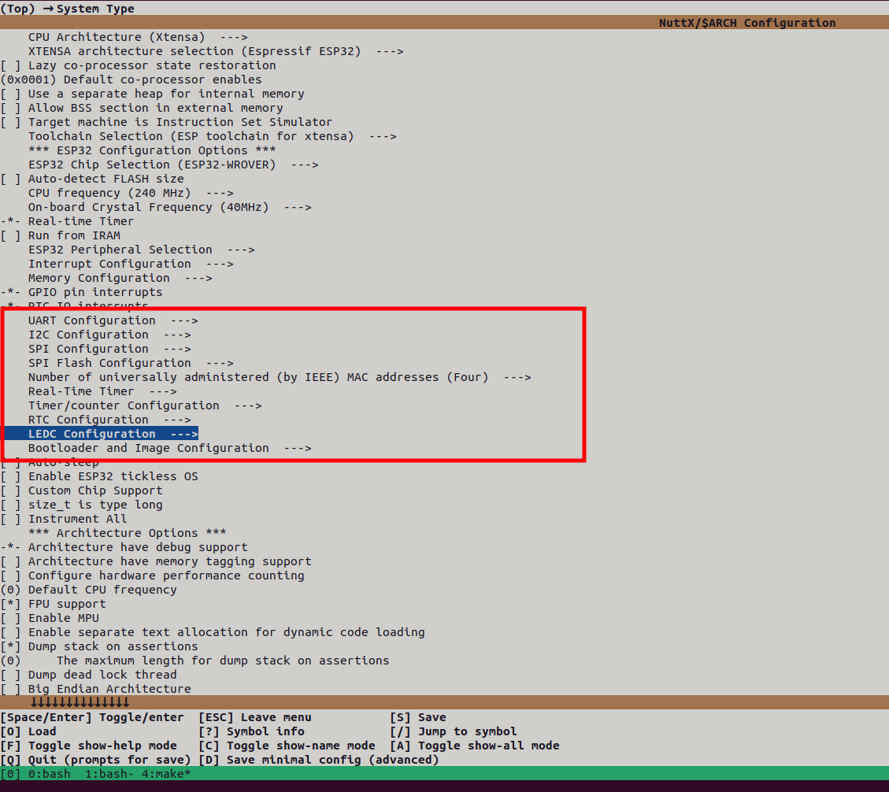
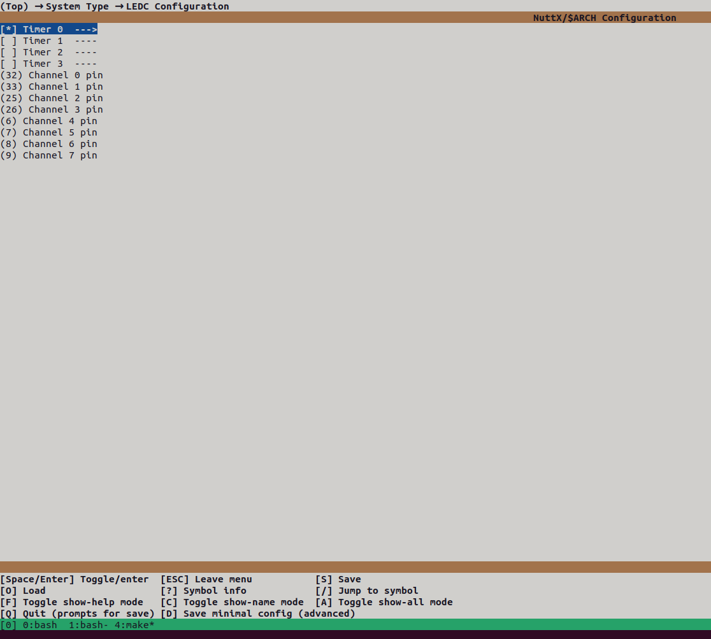

# ESP32

<LinkedBadge type="warning" text="Experimental" url="../flight_controller/autopilot_experimental.md"/>

::: warning
PX4 does not manufacture this (or any) autopilot.
The ESP32 is a chip made by [Espressif](https://www.espressif.com/), sold on many different third-party development boards.
Contact your board's seller for hardware support or compliance issues.
:::

PX4 support for the ESP32 does not target a specific manufacturer's flight controller.
Instead it targets the bare ESP32 chip as found on generic development kits (dev boards) — the kind sold by almost any electronics retailer.

These dev kits are meant for prototyping: you wire up whatever sensors, actuators, or peripherals you want to test, to whatever GPIOs are convenient.
Because of this, PX4 does not define a single fixed pinout for the ESP32 (there is no schematic of "this sensor always goes on this pin" the way there is for a Pixhawk FMU).
Instead, each peripheral (I2C, SPI, PWM) is wired to GPIOs through the board's own configuration, and you are expected to change that configuration to match whatever you have wired up on your bench.

## Overview

ESP32 support is built as a PX4 **cannode**-style target: it runs the control allocator, PWM output, `mavlink`, `dataman`, `gimbal` and `payload_deliverer` modules, but it does **not** run `commander`, the EKF, or any attitude/position estimation and control stack.
In other words, the ESP32 is intended to act as a MAVLink-connected peripheral/companion node — for example to drive PWM outputs, a gimbal, or a payload release, and to expose I2C/SPI sensors to the rest of the system — rather than as the primary flight controller stabilizing a vehicle.

::: info
This is a different use case from the [ESP32 WiFi telemetry module](../telemetry/esp32_wifi_module.md), which describes using an ESP32 module pre-flashed with _DroneBridge for ESP32_ as a WiFi telemetry bridge accessory for a Pixhawk-series flight controller.
This page is about building and running PX4 itself on an ESP32.
:::

## Build Targets

| Target | `make` target | WiFi role | Notes |
| --- | --- | --- | --- |
| WiFi client (station) | `make espressif_esp32_wifi_client` | Connects to an existing access point (DHCP client) | Default build to pair the ESP32 with your home/field WiFi network |
| WiFi access point | `make espressif_esp32_wifi_ap` | Hosts its own access point and DHCP server | Lets a GCS or companion computer connect directly to the ESP32 |
| Legacy | `make espressif_esp32_legacy` | Station mode | Older bootloader configuration, kept for reference/testing |

All three targets currently start MAVLink both on WiFi (UDP, port 14550) and on a UART, and run the same driver stack underneath — they differ mainly in WiFi role and default pin assignment.

## Peripherals

### I2C

Up to 2 I2C buses are available (`PX4_NUMBER_I2C_BUSES`).
The bus' SDA/SCL pins are not fixed — they are set per-board in the NuttX arch configuration (`CONFIG_ESP32_I2C0_SDAPIN` / `CONFIG_ESP32_I2C0_SCLPIN`).

### SPI

Up to 2 SPI buses are available, using the ESP32's `SPI2`/`SPI3` peripherals.
Each bus and its devices (and their CS pin) are declared in the board's `spi.cpp`, so you can add a device simply by declaring it there and picking a free CS GPIO.

### PWM

PWM output uses the ESP32's LEDC peripheral, with 4 independent channels (`DIRECT_PWM_OUTPUT_CHANNELS`).
Each channel's GPIO is set independently (`CONFIG_ESP32_LEDC_CHANNEL0_PIN` .. `CHANNEL3_PIN`).
The output frequency is not hard-coded to one value: like on every other PX4 board, it comes from the actuator output rate-group configuration (set via the Actuators setup in QGroundControl, or the `pwm` command), and the ESP32 LEDC timer honors whatever rate is requested.

### WiFi

WiFi can be brought up either as a **client** (station mode, joining an existing network) or as a **server** (SoftAP, hosting its own network with a DHCP server for a GCS or other device to join) — this is a build-time choice between the `esp32_wifi_client` and `esp32_wifi_ap` targets described above.

## Pinout: Configured, Not Fixed

There is no single ESP32 pinout diagram for PX4, because the board is not tied to one piece of hardware.
As an illustration, compare the default pin assignment PX4 ships for the two WiFi targets — both are valid, and neither is "the" ESP32 pinout:

| Peripheral | `esp32_wifi_client` default | `esp32_wifi_ap` default |
| --- | --- | --- |
| I2C0 SDA / SCL | board default | GPIO 22 / GPIO 21 |
| PWM channel 0 / 1 / 2 | board default / GPIO 13 / GPIO 16 | GPIO 32 / GPIO 33 / GPIO 25 |
| UART1 RX / TX | GPIO 14 / GPIO 12 | GPIO 4 / GPIO 2 |

To change any of this for your own wiring, there are two separate configuration layers:

- **PX4 module/driver configuration** (which modules are built, high-level board options): run `make espressif_esp32_wifi_client boardconfig` (or `boardguiconfig` for the GUI version), or edit the target's `default.px4board` file directly.
- **NuttX chip/pin configuration** (which GPIO each I2C/SPI/PWM/UART peripheral uses): run `make espressif_esp32_wifi_client menuconfig`, which opens NuttX's own Kconfig menu for the `xtensa/esp32` chip. Saving writes back into the board's `nuttx-config/nsh/defconfig`.

### Choosing Pins in menuconfig

Under **System Type**, each peripheral has its own submenu — `UART Configuration`, `I2C Configuration`, `SPI Configuration`, `SPI Flash Configuration`, `Timer/counter Configuration`, `RTC Configuration`, `LEDC Configuration` (PWM), and `Bootloader and Image Configuration`:



For example, opening `LEDC Configuration` enables the timer(s) you want and lets you assign any GPIO to any PWM channel:



The same pattern applies to the other submenus — enable the peripheral/instance you want, then set its pin(s) to whichever GPIOs you've wired up.

Additional UARTs work the same way: open `UART Configuration`, enable the extra UART instance you need, and assign its RX/TX pins.

::: warning
Make sure the pin you assign to any peripheral (UART RX/TX included) is not already used by another peripheral or by a fixed-function pin on your module.
A pin conflict typically prevents the board from booting at all, rather than failing gracefully.

If the board doesn't come up after a menuconfig change, check the boot log for:

```
TODO: exact boot error text for a pin conflict
```

That message indicates a pin conflict — revisit your pin assignments in menuconfig.
:::

## Building

The `xtensa-esp32-elf` cross-compiler and `esptool` are installed automatically by [Tools/setup/ubuntu.sh](https://github.com/PX4/PX4-Autopilot/blob/main/Tools/setup/ubuntu.sh) on x86_64 Ubuntu hosts.

```sh
make espressif_esp32_wifi_client
# or
make espressif_esp32_wifi_ap
```

### Toolchain Versions

This target has been built and tested with:

- **Compiler (`xtensa-esp32-elf-gcc`):** TODO
- **esptool:** v4.11.dev2

## Flashing

Flash the built image with [esptool.py](https://docs.espressif.com/projects/esptool/en/latest/esp32/):

```sh
esptool.py -c esp32 -p /dev/ttyUSB0 -b 115200 write_flash -fs detect -fm dio -ff 40m 0x1000 ./build/espressif_esp32_wifi_client_default/espressif_esp32_wifi_client_default.bin
```

Replace `/dev/ttyUSB0` with the serial port your dev kit enumerates as, and the `.bin` path with the output of whichever target you built (for example `espressif_esp32_wifi_ap_default`).

## Status and Limitations

This board target is **experimental** and under active development — see the [Experimental Autopilots](../flight_controller/autopilot_experimental.md) page for what that means in terms of support.
In particular:

- It is a peripheral/companion-node style target (no `commander`/EKF/flight control stack), not a drop-in replacement for a Pixhawk-class flight controller.
- Default pin assignments (shown above) are examples, not a recommendation — check your target's `nuttx-config/nsh/defconfig` and `src/board_config.h` before wiring up hardware.

## See Also

- [ESP32 WiFi Telemetry Module](../telemetry/esp32_wifi_module.md) — using an ESP32 as a WiFi telemetry bridge for a Pixhawk-series controller (a different use case from this page).
- [PX4 Menuconfig Setup](../hardware/porting_guide_config.md#px4-menuconfig-setup) — more detail on `boardconfig`/`boardguiconfig`.
